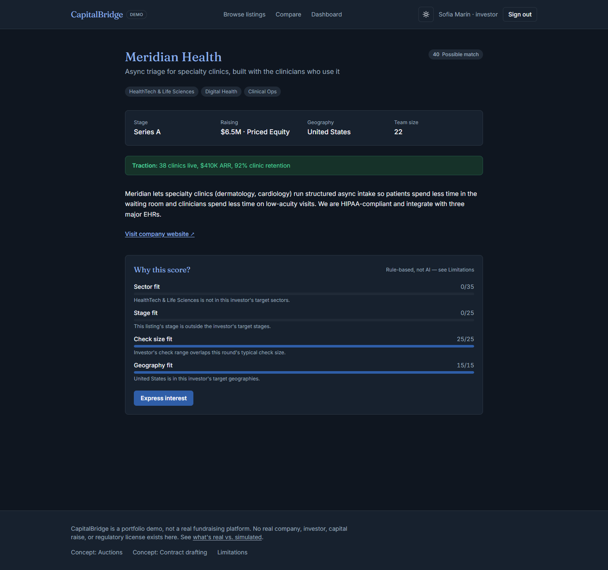
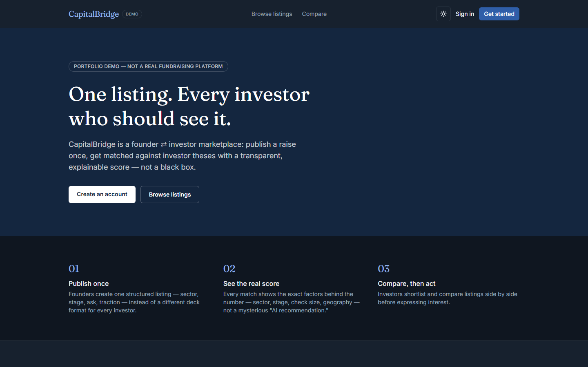
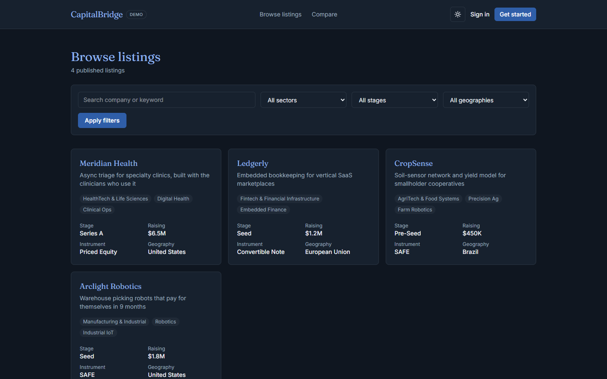
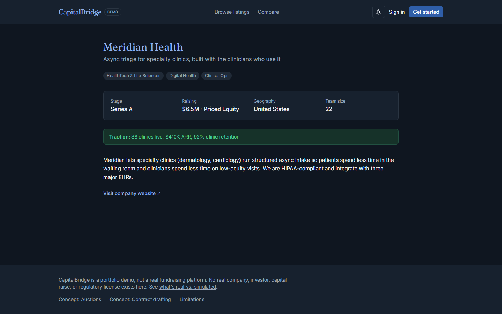
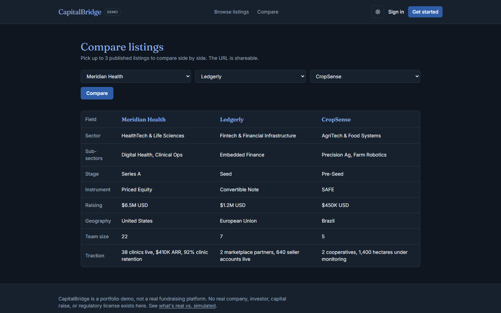
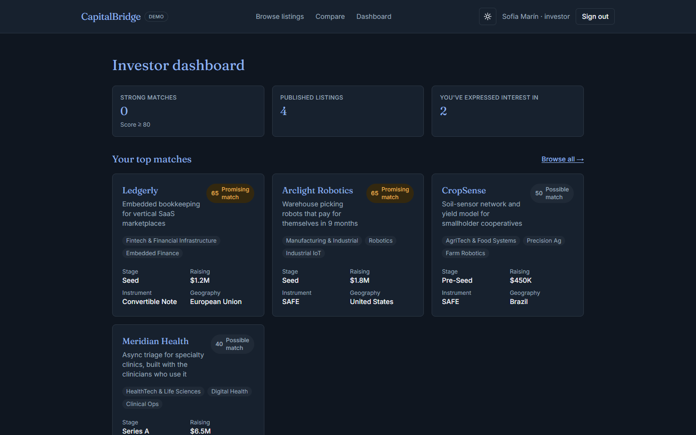
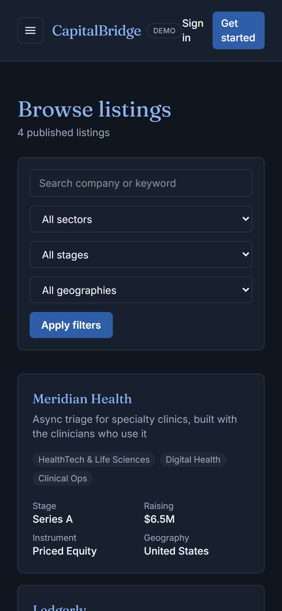

# CapitalBridge

**Founder ⇄ investor matching with a transparent score: every match shows exactly which factors drove it.**

> **Portfolio demo, not a real fundraising platform.** No real company, investor, capital raise,
> or regulatory license exists here. See [docs/LIMITATIONS.md](docs/LIMITATIONS.md) for the full
> honest-status breakdown, or visit `/docs-limitations` in the running app.

A founder ⇄ investor marketplace MVP: founders publish structured fundraising listings, investors
set an investment thesis and get a transparent, explainable compatibility score against every
listing, browse/filter/compare, and record interest.



Built from a Technical Project Dossier for "CapitalBridge" — see
[docs/PROJECT_CONTEXT.md](docs/PROJECT_CONTEXT.md) for how a 20-feature, multi-jurisdiction
architecture memo became this scoped, honestly-labeled MVP.

## Problem

Founders reformat the same pitch for every investor they reach, with no upfront signal for who's
actually a fit. Investors sourcing deal flow get pitched broadly, with no transparent reasoning
for why a company matches their thesis.

## Solution

One structured listing per founder, matched against every investor's stated thesis with a
deterministic, explainable score — every match shows exactly which factors (sector, stage, check
size, geography) drove the number, not a black-box "AI recommendation."

## Features

- Founder: create/edit/publish/archive listings; real view + interest counts; views-by-day chart
- Investor: set a thesis; browse/filter/search published listings; see an explainable match score
  on every listing; express interest; compare up to 3 listings side by side (shareable URL)
- Admin: moderate any listing, view all users
- Concept-preview screens (clearly labeled, non-functional) for auction/bidding and AI contract
  drafting — showing product thinking without faking legal/financial functionality
- Light and dark themes — follows the OS setting by default, with a toggle in the header (in the
  menu on phones); the choice is remembered per browser
- Full documentation set in [`docs/`](docs) — see the index below

## Screenshots

| Landing | Browse listings |
|---|---|
|  |  |

| Listing detail | Compare |
|---|---|
|  |  |

| Investor dashboard (signed in) |
|---|
|  |

<p>
  
</p>

*Phone-sized screen (390 px wide). Screenshots use the dark theme; the app also has a light theme
(toggle in the header, or it follows your OS setting).*

All of these are real screenshots of the app running locally, not mockups. The investor dashboard
and the match-score view at the top of this README were captured signed in as the seeded demo
investor; every company, investor and number is fictional seed data.
The founder dashboard and admin panel are not pictured — see [docs/DEMO.md](docs/DEMO.md) to see
them live in under a minute with the seeded demo accounts.

## Architecture

One Next.js 16 (App Router) app — Server Components for reads, Server Actions for writes, Prisma
+ SQLite for persistence (Postgres-ready). No microservices, no message queue — see
[docs/ARCHITECTURE.md](docs/ARCHITECTURE.md) and [docs/DECISIONS.md](docs/DECISIONS.md) for why
that's the right call at this scale, not an oversight.

```
Browser → Next.js App Router → Server Components / Server Actions → Prisma → SQLite
```

## Tech stack

Next.js 16, React 19, TypeScript, Tailwind CSS v4, Prisma + SQLite, Zod, `jose` (JWT), `bcryptjs`,
Recharts, Vitest.

## Demo instructions

See [docs/DEMO.md](docs/DEMO.md) for demo accounts and a suggested walkthrough.

## Installation

```bash
npm install
cp .env.example .env       # or edit the auto-generated .env
npm run db:push             # create the SQLite database
npm run db:seed             # load demo data
npm run dev                  # http://localhost:3000
```

Run tests: `npm test`. Run the production build: `npm run build && npm run start`.

## Environment variables

| Variable | Required | Purpose |
|---|---|---|
| `DATABASE_URL` | yes | SQLite file path (`file:./dev.db` locally) |
| `JWT_SECRET` | yes | Signs session cookies — generate a fresh value per environment |

Full detail: [docs/DEPLOYMENT.md](docs/DEPLOYMENT.md).

## Project structure

```
capitalbridge/
├── prisma/           # schema + seed script
├── src/app/           # routes (Next.js App Router)
├── src/components/     # shared UI
├── src/lib/             # business logic, auth, actions, data access
└── docs/                # full documentation set (see below)
```

## API

No public REST/GraphQL API — Server Actions only. See [docs/API_SPEC.md](docs/API_SPEC.md).

## Security

Demo-grade auth (bcrypt + JWT cookie), server-side authorization on every mutation, Zod input
validation, no raw SQL, no `dangerouslySetInnerHTML`. Full review: [docs/SECURITY.md](docs/SECURITY.md).

## Roadmap

Phased path to the parts of the source dossier not yet built (real compliance, payments, auctions,
contract drafting, scraping): [docs/ROADMAP.md](docs/ROADMAP.md).

## Limitations

[docs/LIMITATIONS.md](docs/LIMITATIONS.md) — the authoritative real/mocked/not-implemented list.
Also live in the app at `/docs-limitations`.

## Business & product overview

**Problem**: fragmented, low-signal founder↔investor discovery. **Target customer**: early-stage
founders raising $250K–$10M, and angels/funds sourcing deal flow. **Differentiation**:
explainable matching instead of a black box, and a fee-free (no equity/carry) positioning per the
source dossier's competitive analysis. **Monetization possibility**: listing fees + success fees,
per the dossier — not validated with any real customer here. **Current stage**: MVP/demo, no
revenue, no users, no funding. See [docs/PROJECT_CONTEXT.md](docs/PROJECT_CONTEXT.md) for the
full picture, including what was invented vs. taken directly from the source dossier.

## Portfolio case study

[docs/PORTFOLIO_CASE_STUDY.md](docs/PORTFOLIO_CASE_STUDY.md) — what was built, the approach, key
decisions, challenges, and current status.

## Documentation index

[PROJECT_CONTEXT](docs/PROJECT_CONTEXT.md) · [PRODUCT_REQUIREMENTS](docs/PRODUCT_REQUIREMENTS.md) ·
[ARCHITECTURE](docs/ARCHITECTURE.md) · [USER_FLOWS](docs/USER_FLOWS.md) ·
[API_SPEC](docs/API_SPEC.md) · [DATA_MODEL](docs/DATA_MODEL.md) · [SECURITY](docs/SECURITY.md) ·
[ROADMAP](docs/ROADMAP.md) · [DECISIONS](docs/DECISIONS.md) · [DEMO](docs/DEMO.md) ·
[DEPLOYMENT](docs/DEPLOYMENT.md) · [TESTING](docs/TESTING.md) · [LIMITATIONS](docs/LIMITATIONS.md) ·
[CHANGELOG](docs/CHANGELOG.md) · [PORTFOLIO_CASE_STUDY](docs/PORTFOLIO_CASE_STUDY.md)

## Future development

See [docs/ROADMAP.md](docs/ROADMAP.md).

## License

MIT — see [LICENSE](LICENSE).
